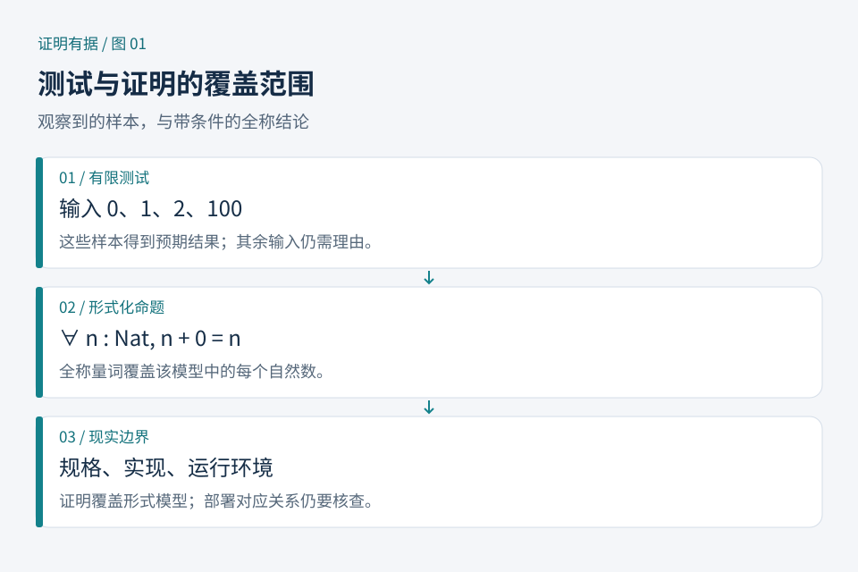

# 第01章　为什么程序跑通以后，还要证明

一段程序在十个例子上给出正确答案，说明这十次运行通过了检查。若程序接收任意长度的列表，十个例子没有穷尽输入；若它有超时、溢出和异常，检查的条件也未必完整。测试提供具体运行的证据，形式化证明则要求先把性质写成精确命题，再按规则建立一般结论。两者回答的问题不同，可以共同使用。

本书讨论的 Lean 是 Lean 4 证明助手与编程语言，Rocq 是原名 Coq 的证明助手。它们允许定义对象、编写函数、陈述定理并构造可由机器检查的证明。本书的“形式化”，指把对象与推理写进有明确规则的语言；“验证”，指检查某个形式对象是否满足已经陈述的性质。[资料：Lean 官方《语言参考》简介](https://lean-lang.org/doc/reference/latest/)；[Rocq 项目说明](https://github.com/rocq-prover/rocq)。



*图 1：测试与证明的覆盖对象。图中的范围是教学示意；形式证明的覆盖范围取决于命题中的输入域与假设。*

## 1.1 一个看似无聊，却能暴露差别的问题

设 `append xs ys` 把两个列表接起来。我们希望结果长度等于两段长度之和。用自然语言写，就是：对任意列表 `xs` 与 `ys`，都有

```text
length (append xs ys) = length xs + length ys
```

可以先测空列表、单元素列表和长列表。若实现误把第二个列表重复一遍，普通例子就能发现。若所有测试通过，仍需追问：长度为一百万时怎样？两段都为空怎样？列表元素换成字符串会怎样？

证明的思路不必逐个枚举。列表只有两个构造入口：空列表，或一个元素接在较短列表前面。只要处理空列表，并证明性质能从较短列表传递到新增一个元素的列表，就建立了覆盖任意有限列表的归纳论证。第八章将把这条推理写成 Lean 与 Rocq 的代码。

这个例子还有一个容易被忽略的条件：这里的列表是形式语言中的有限列表，长度使用数学意义的自然数。如果把结论拿去解释某个使用定长整数、会发生内存分配失败的外部程序，还需建立实现与模型之间的联系。“证明了算法性质”和“证明了部署系统的全部行为”是不同层面的工作。

## 1.2 先审查说法，再审查证明

考虑“排序函数正确”。这句话不足以检查：函数把所有输入都变成空列表，输出当然已经有序，却丢失了数据。一个较完整的规格通常至少包括两件事：结果有序；结果与输入有相同的元素及出现次数。

这说明规格并非随手写下的标题。它决定正确性的含义。若要求是“非递减顺序”，重复元素是允许的；若错误地写成“严格递增”，含重复元素的输入便无法满足规格。此时证明失败可能是在帮助我们修正规格，而不是提示策略不够强。

读任何正式定理时，可以依次问：

1. 对哪些输入成立？是否排除了空输入、零值或异常状态？
2. 依赖哪些前提？这些前提在真实使用场景中由谁保证？
3. 结论究竟保证什么？是否遗漏数据保留、终止或错误处理？

这些问题属于人的建模与审查责任。内核能够检查推导符合规则，无法替读者决定“这是不是原本需要的需求”。

## 1.3 证明助手在帮助谁做什么

纸面证明常省略显然步骤，例如“整理可得”“由归纳假设立即成立”。机器检查要求每一步最终有足够的形式依据。人可以通过策略、现成定理和自动化省去重复劳动，但交付的证据需要落在系统能够检查的语言中。

Lean 与 Rocq 都以类型论组织这类证据。初学时不必先掌握完整理论：可以把“待证命题”看成需要填满的位置，把已经掌握的假设看成可用材料。证明过程中，系统显示还差什么；提供的材料不匹配时，它给出诊断。下一章解释为什么这不只是界面比喻。

证明助手也不意味着每个问题都有自动解法。一个复杂问题可能需要新的定义、中间引理、合适的归纳对象，甚至新的数学想法。自动化通常在特定问题范围内很有效，范围之外仍需要选择证明路线。

## 1.4 可靠性的边界在哪里

一个正式结果值得怎样信任，要看整条链路：规格是否表达了意图；模型是否覆盖场景；证明是否依赖额外公理；检查器及运行环境是否可信；若结论用于外部程序，连接过程是否得到论证。

例如，证明某个函数对所有自然数返回非负数，本身没有涉及网络、文件权限或机密信息。因此不能把它宣传成“程序安全”。反过来，一个范围有限但陈述清楚的定理仍很有价值：它使保证可以被审查、复用，并在代码变化后重新检查。

Lean 官方说明把用户语法的细化与核心检查分开；策略主要负责帮助生成形式项，内核负责检查其类型。这个设计缩小了需要直接信任的核心，但不消除软件实现出错的可能。[资料：Lean《Elaboration and Compilation》](https://lean-lang.org/doc/reference/latest/Elaboration-and-Compilation/)。本书讨论可信边界时始终保留这一区别，不把“机器检查”解释成脱离条件的绝对保证。

## 1.5 本书怎么读

前四章建立共同语言，第五至八章用同一组问题分别练习 Lean 与 Rocq，第九章以后把练习接到规格、工程和真实案例。第一次阅读可以先选一种语言运行，另一种作为对照；不必为了比较而同时安装完整生态。

本书把短小示例拆开写，是为了让读者看见每个目标怎样变化。练熟以后，库中的成熟定理通常能让证明更短，但短并不自动意味着清楚。学习目标是能解释命题、追踪证据、判断边界，并能在遇到错误时缩小问题。

**观察练习。** 某函数声称“删除列表中的重复元素”，只证明了输出没有重复，够不够？

**参考解答。** 不够。始终返回空列表也满足这一性质。还应约束输出与输入的元素关系；若需求保留首次出现顺序，还需进一步描述顺序。先完善规格，再讨论证明方法。
