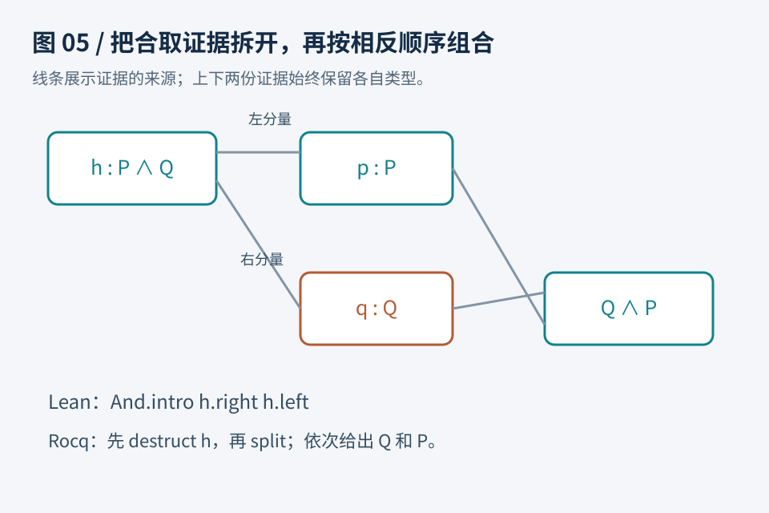

# 第05章　第一个双语言证明：把已知条件变成所需结论

假设系统里有两个条件：账户已登录，且操作已获授权。我们暂时不讨论登录怎样实现，只把两件事记为命题 P、Q。现在希望证明：如果 P 与 Q 同时成立，那么 Q 与 P 也同时成立。这个问题很小，却足以展示一段形式化证明的完整工作：明确变量、接收假设、拆开证据、分别完成目标。

这里的 P、Q 可以替换成任意命题。我们没有偷偷假定它们为真；我们证明的是一种转换关系。即使某次操作根本没有登录，这条转换规则仍成立，因为它只承诺在给定前提成立时产生结论。写规格时，这种区别十分关键。



图5：证明 P∧Q→Q∧P 的结构。接收前提后，取出 Q 的证据与 P 的证据，分别填入结论的两个位置。箭头表示证据的使用方向。

## 在 Lean 中写完证明

以下代码不依赖 mathlib。`Prop` 表示命题所在的类型；`∧` 表示“并且”；`→` 表示“如果……那么……”。Unicode 符号可以通过编辑器输入，也可以复制代码。本书的完整示例集中在 `examples/lean/Practice.lean`。

```lean
theorem swapAnd (P Q : Prop) : P ∧ Q → Q ∧ P := by
  intro h
  constructor
  · exact h.right
  · exact h.left
```

第一行在声明一条名为 `swapAnd` 的定理。冒号后面是它要证明的命题；`:= by` 后面是构造证明的过程。开始时，P、Q 已经在上下文中，但还没有 P 或 Q 的证据。

`intro h` 接收箭头左边的前提。因此上下文增加 `h : P ∧ Q`，目标从 `P ∧ Q → Q ∧ P` 变成 `Q ∧ P`。读作：“给我同时证明 P、Q 的 h，我需要交还同时证明 Q、P 的东西。”这里不是把前提当成新定理，而是在证明一个带条件的命题。

`constructor` 根据合取的构造方式，把目标拆成两个：先证明 Q，再证明 P。圆点 `·` 组织两个独立分支。`h.right` 是 h 里关于 Q 的证据，正好符合第一个目标；`h.left` 则完成第二个目标。`exact` 表示提供一个与当前目标相符的完整证据。策略如何逐步产生证明项，见 Lean 官方教材的 [Tactics](https://lean-lang.org/theorem_proving_in_lean4/Tactics/)；此处具体的账户类比与代码安排是本书的教学示例。

可以在编辑器里把光标移到每行之后，观察目标数量：一个、一个、两个、一个、零。目标变多并不表示退步。一个复杂承诺拆成两个更简单的承诺，往往正是证明在前进。真正的完成标准是每个分支都关闭，而不是最后一行看起来像结论。

## 在 Rocq 中完成同一件事

Rocq 通常用 ASCII 写逻辑符号：`/\` 表示合取。它的证明脚本以 `Proof.` 开始，以 `Qed.` 结束，句点是命令结束标志。

```rocq
Theorem swap_and : forall P Q : Prop, P /\ Q -> Q /\ P.
Proof.
  intros P Q h.
  destruct h as [hp hq].
  split.
  - exact hq.
  - exact hp.
Qed.
```

`forall P Q : Prop` 把“任意两个命题”写在陈述内部。`intros P Q h` 按顺序把 P、Q 和前提 h 引入当前上下文。`destruct h as [hp hq]` 把合取证据拆开，给两部分分别命名。`split` 把目标合取拆成两个目标；两个短横线标明分支边界。

注意 `destruct` 与 `split` 出现的位置：前者作用于已有证据 h，后者作用于尚待完成的目标。初学者容易把它们看成同一件事，因为都涉及“分开”；但证明状态中一个在已知区，一个在目标区。Rocq 官方参考手册在 [Tactics](https://rocq-prover.org/doc/V9.0.0/refman/proof-engine/tactics.html) 区分了证明状态、子目标与策略操作。本书优先使用这些直接步骤，以便读者看清证据从哪里来。

## 证明一条推理规则

再看一个更通用的模式：已经知道 P 能推出 Q，又知道 P，那么可以得到 Q。

```lean
theorem passAlong (P Q : Prop) : (P → Q) → P → Q := by
  intro f hp
  exact f hp
```

```rocq
Theorem pass_along : forall P Q : Prop, (P -> Q) -> P -> Q.
Proof.
  intros P Q f hp.
  exact (f hp).
Qed.
```

这里 `f` 是从 P 的证据到 Q 的证据的转换，`hp` 是 P 的证据，`f hp` 因而是 Q 的证据。这也解释了为什么证明中出现函数应用：蕴含可以通过接收前提证据、返回结论证据来表达。两套工具的语法不同，但这个例子的推理结构一致。相关背景可对照 Lean 的 [Propositions and Proofs](https://lean-lang.org/theorem_proving_in_lean4/Propositions-and-Proofs/)。

## 全称与存在：承诺的方向不同

`∀ n : Nat, n = n` 要求对任意自然数 n 给出证明。`∃ n : Nat, n = n` 只要求挑出一个自然数并证明它满足性质。前者可以接收任意输入，后者必须交出一个见证。不能用“我找到了 0”去完成“任意 n”，也不能只写“总有一个”而不提交见证。

```lean
theorem existsSelf : ∃ n : Nat, n = n := by
  exact ⟨0, rfl⟩
```

```rocq
Theorem exists_self : exists n : nat, n = n.
Proof.
  exists 0.
  reflexivity.
Qed.
```

这里选择 0 是因为性质很弱，任何自然数都行。`rfl` 和 `reflexivity` 完成等式自反性。Lean 的 `⟨0, rfl⟩` 把见证与证明写成一个整体；Rocq 的两行先确定见证，再完成剩余目标。关于量词与见证的正式语法可查 [Quantifiers and Equality](https://lean-lang.org/theorem_proving_in_lean4/Quantifiers-and-Equality/)。

## 量词顺序会改变承诺

读到带有多个量词的规格时，应从左到右看谁先选择。对于“每个订单都有一个对应记录”，可以针对不同订单选择不同记录；对于“存在一个记录，能对应所有订单”，必须先选出同一条记录，再让它适用于所有订单。这两个陈述并不等价。自然语言把“有一个”“每一个”随手挪动，可能改变整个系统要承担的保证。

例如 `∀ n : Nat, ∃ m : Nat, m = n` 很容易成立：接收 n 以后选择同一个 n 作为 m。Lean 可以写：

```lean
example : ∀ n : Nat, ∃ m : Nat, m = n := by
  intro n
  exact ⟨n, rfl⟩
```

Rocq 可以写：

```rocq
Example choose_same : forall n : nat, exists m : nat, m = n.
Proof.
  intro n.
  exists n.
  reflexivity.
Qed.
```

如果改成“存在 m，使任意自然数 n 都等于 m”，就不成立：n 取零与取一时不能同时等于同一个自然数。这里不是工具语法太严格，而是两种需求确实不同。形式化的一个实际收益，就是迫使我们在证明之前把这种选择顺序说清楚。

同样要注意假设的作用范围。证明 `P → Q` 时暂时引入的 P，只服务于这条带条件的证明，不能在结束后当作没有条件的全局事实。证明状态中的上下文更像当前任务可使用的资料清单；局部引入证据不会自动扩大外部系统已经知道的事情。

## 失败信息怎样帮助我们

如果在 Lean 的第一个分支写 `exact h.left`，目标是 Q，提交的却是 P 的证据。除非 P、Q 恰好有额外关系，否则类型不匹配。修复不是改变目标迎合代码，而是检查取错了哪个分量。

如果 Rocq 在 `split` 之前执行 `exact hq`，当前目标仍是 `Q /\ P`，单独的 hq 不足以完成合取。先确定目标最外层的逻辑结构，再选动作，通常比背策略列表可靠。

练习：证明 `P → Q → P ∧ Q`。可以先用纸写出三件事：接收 P 的证据；接收 Q 的证据；组合两者。Lean 的答案是 `by intro hp hq; exact ⟨hp, hq⟩`，放在 `example (P Q : Prop) : P → Q → P ∧ Q :=` 后面。Rocq 可写 `Theorem pair_up : forall P Q : Prop, P -> Q -> P /\ Q.`，再写 `Proof. intros P Q hp hq. split. exact hp. exact hq. Qed.`。尝试完成后，把两个证据调换，观察错误如何对应目标的左右顺序。

这一章的成果不是记住五个命令，而是能回答：当前需要什么证据？手头有哪些证据？哪种构造把两者连接起来？接下来处理等式时，我们仍然围绕这三个问题展开。
