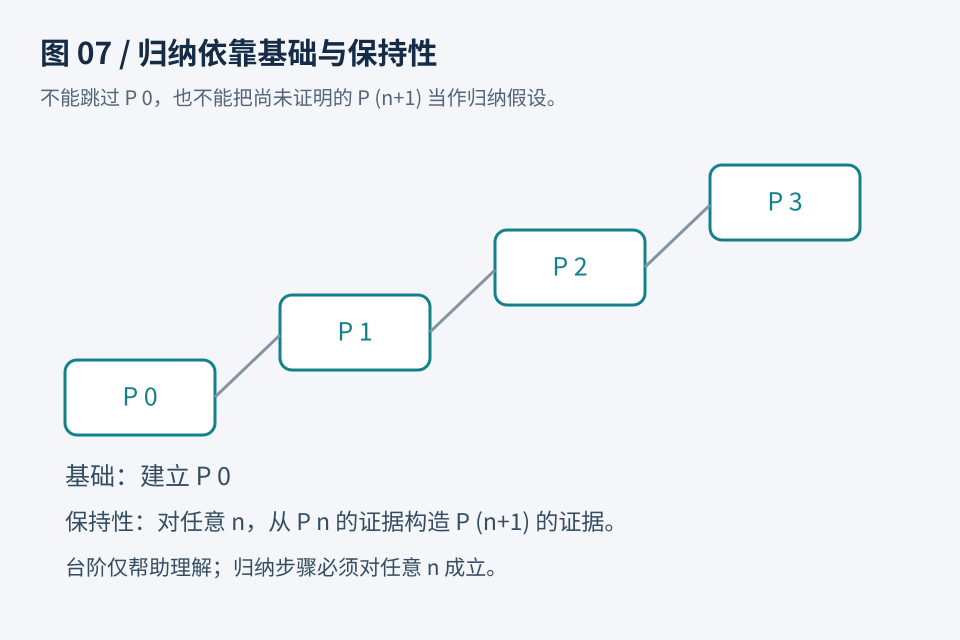

# 第07章　自然数与归纳：从递归的形状找到证明的形状

检查零加零、一加零、二加零，可以建立“加零不变”的直觉，却不能用有限次检查覆盖全部自然数。数学归纳法换了一种工作：证明起点成立，再证明任何一个成立的阶段都能延伸到下一个阶段。它不是预测后面的数大概也一样，而是建立一条能覆盖自然数构造方式的规则。

自然数可以从零出发，反复应用“后继”构造。Lean 把后继写作 `Nat.succ`，Rocq 写作 `S`。因此 2 可以理解为零的后继的后继。证明关于自然数的命题时，零与后继恰好给出两类情况。Lean 的官方教材 [Induction and Recursion](https://lean-lang.org/theorem_proving_in_lean4/Induction-and-Recursion/) 讲解了这种结构与递归、归纳的关系。



图7：归纳证明的两个义务。基础情形不能省略；归纳步骤必须使用任意阶段的假设，而不是只检查一个具体数。

## 先明确一个可计算的定义

为了让两套工具的计算方向一致，我们暂时自己定义一个加法函数。名称取为 `addLeft` 或 `add_left`，强调它按第一个参数递归。生产代码通常优先使用标准库，本例重写定义是为了显露证明结构。

```lean
def addLeft : Nat → Nat → Nat
  | 0, m => m
  | Nat.succ n, m => Nat.succ (addLeft n m)
```

它只有两条规则：第一个参数为零时，返回第二个参数；第一个参数是 n 的后继时，先计算 n 与第二个参数的加法，再取后继。比如 `addLeft 2 3` 展开为两个后继包住 `addLeft 0 3`，最后得到 5。

```rocq
Fixpoint add_left (n m : nat) : nat :=
  match n with
  | O => m
  | S k => S (add_left k m)
  end.
```

Rocq 中 `Fixpoint` 声明递归定义，`match` 区分数据的构造情况。这里递归调用的第一个参数从 `S k` 变成它的子结构 k，给出了清晰的终止依据。关于递归定义及其限制，可查 Rocq 官方 [Inductive types and recursive functions](https://rocq-prover.org/doc/V9.0.0/refman/language/core/inductive.html)。本书只在最直接的结构递归上起步，不把所有终止性问题都归结为“参数的数值看起来变小”。

有了定义，`addLeft 0 m = m` 在 Lean 中可用 `rfl` 完成；Rocq 的对应等式可用 `reflexivity` 完成。因为定义直接给出答案。但 `addLeft n 0 = n` 的第一个参数是未知的 n，计算还不知道选哪个分支。数学上看着同样简单，形式上的证明路径却不同。

## Lean：把两个分支写清楚

```lean
theorem addLeft_zero (n : Nat) : addLeft n 0 = n := by
  induction n with
  | zero => rfl
  | succ n ih =>
      change Nat.succ (addLeft n 0) = Nat.succ n
      rw [ih]
```

`induction n` 产生零与后继两个分支。零分支要求 `addLeft 0 0 = 0`，直接按定义计算完成。

后继分支有一个较小的自然数 n，以及 `ih : addLeft n 0 = n`。目标则是 `addLeft (Nat.succ n) 0 = Nat.succ n`。`change` 把目标显示成按定义展开一层后的形式，它要求新旧目标在定义计算意义下相容，并不是任意更改定理。接下来 `rw [ih]` 把内层 `addLeft n 0` 换成 n，剩下同一个后继等于自身。

把这段证明读成自然语言，就是：“零的情况成立。假设 n 加零等于 n，那么 n 的后继加零，按定义等于 n 加零的后继，再用假设，等于 n 的后继。”归纳假设只在这个后继分支可用，而且只保证较小结构的性质。它没有预先假定整条定理成立，因此不存在循环论证。

## Rocq：在证明状态里找到归纳假设

```rocq
Theorem add_left_zero : forall n : nat, add_left n 0 = n.
Proof.
  intro n.
  induction n as [| k ih].
  - reflexivity.
  - simpl.
    rewrite ih.
    reflexivity.
Qed.
```

`as [| k ih]` 指明分支命名：零分支不带内部参数；后继分支把较小数命名为 k，把归纳假设命名为 ih。`simpl` 展开后继分支的计算，接着 `rewrite ih` 使用 `add_left k 0 = k`。Rocq 的 [induction 策略参考](https://rocq-prover.org/doc/V9.0.0/refman/proof-engine/tactics.html#coq:tacn.induction) 可用于查询额外参数，但本章先保持最小结构。

观察两个工具的证明时，不要只寻找命令名称是否相似。更有价值的对应是：分了哪几种情况？每种情况增加了什么假设？递归调用出现在目标的什么位置？最终需要哪条等式把它替换掉？这四个问题也适用于树、语法表达式和后来的程序执行关系。

## 为什么仅仅分类讨论不够

把 n 分成零和后继，叫分类讨论；在后继情况同时得到较小 n 的性质，才是此处所需的归纳。若只做分类，后继分支还会卡在 `add_left k 0`。你知道 k 是一个自然数，却不知道它加零有什么性质。

因此 `cases` 或 `destruct` 与 `induction` 不应混为一谈。对布尔值证明简单性质时，穷尽真与假可能已经足够；对递归数据的全局性质，归纳假设往往是关键。选择哪种方法，要看目标是否需要把“较小结构已经成立”连接到当前结构。

## 归纳假设太弱时怎么办

设想一个尾递归反转函数，它接受待处理列表与累积器。递归时不仅列表缩短，累积器也改变。如果开始证明时把累积器固定死，归纳假设可能只适用于旧累积器，无法用于递归调用中的新累积器。

这时需要加强命题：对任意累积器都成立，再对列表归纳。Lean 可在合适场景使用 `induction xs generalizing acc`，Rocq 可先 `revert acc`，再对 xs 归纳。这里不是放宽正确性的要求，反而是让归纳假设覆盖递归实际产生的所有参数。具体脚本还取决于函数定义与目标，不能把这两个命令当作通用修复咒语。

初学时可用一个判断方法：把递归调用的实参抄下来，再把归纳假设中的变量抄下来。如果某个实参改变了，而假设只允许旧值，应该重新审视命题的量词与归纳顺序。盲目多调用几次化简，通常不会凭空补出缺少的泛化。

## 练习与答案

练习一：证明 `addLeft 0 m = m`，应归纳 m 吗？不需要。第一条定义方程直接适用。Lean 可以写 `example (m : Nat) : addLeft 0 m = m := by rfl`。Rocq 可写 `Example add_left_zero_first : forall m, add_left 0 m = m. Proof. intro m. reflexivity. Qed.`。这说明不是看见“任意自然数”就必须归纳。

练习二：如果把递归函数错误定义成在后继分支继续调用同一个 `S k`，会发生什么？在这类直接结构递归定义中，工具无法认可递归调用沿指定结构下降。需要检查算法与终止性论证，而不能只删掉报错。允许描述不终止计算的其他框架是另一个问题，并不改变本例的终止要求。

练习三：后继分支中 ih 的内容是什么？答案是关于较小参数的原命题：`addLeft n 0 = n` 或 `add_left k 0 = k`。如果写成了当前目标“后继 n 加零等于后继 n”，就把待证结论误当成了假设。能准确说出 ih 的作用范围，比能默写整段脚本更能说明你理解了归纳。
