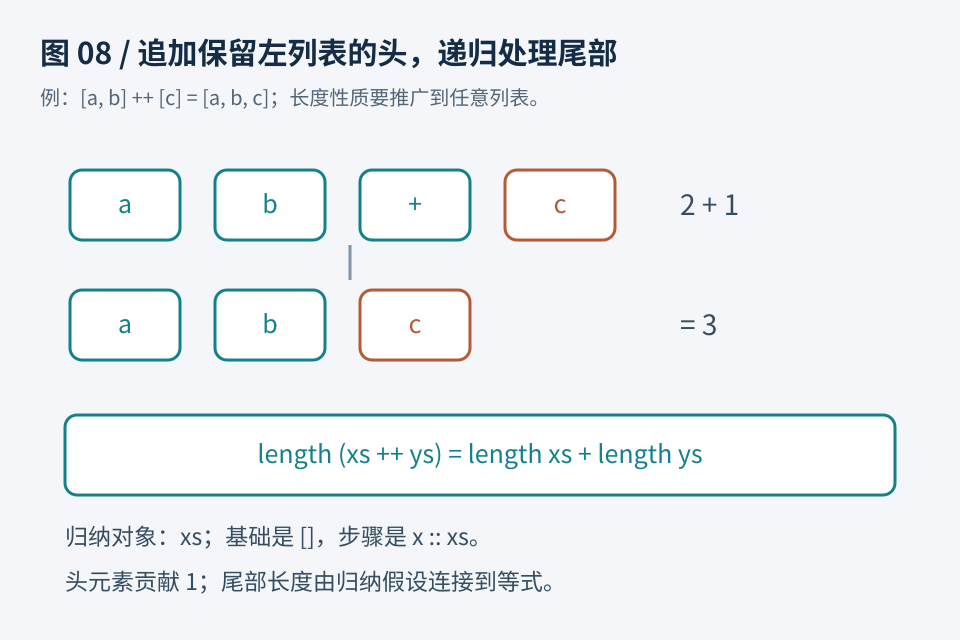

# 第08章　列表与程序性质：证明拼接不会改变数量

自然数的归纳看起来像基础数学。列表让同样的方法进入普通程序：把两个列表拼起来，结果的元素数量应该等于两边数量之和。这个性质比“用三个例子跑出来都对”更强，因为它讨论任意长度、任意元素的列表；但它仍比“拼接实现完全正确”弱，因为数量正确还不足以保证内容与顺序正确。

本章把实现和性质放在一起，读者可以看到递归算法如何产生证明义务。我们使用工具已有的列表类型，自己写拼接与计数函数，名称取为 `join` 和 `count`，方便看清每一步。实际项目一般优先复用库中现有实现与引理。



图8：图中的标准列表长度与拼接概念，在本章代码中分别用自定义 `count` 与 `join` 展示。拼接函数沿第一个列表递归。空列表直接返回右侧；非空列表保留头元素，再拼接尾部。长度证明跟随这两种结构。

## 列表不是预先给定长度的数组

列表有空与非空两种形状。空列表写作 `[]`；非空列表可以拆成一个头元素 x 与剩余列表 xs，写作 `x :: xs`。例如三个元素的列表可看成“头元素 a，加上由 b、c 构成的尾部”。尾部不是最后一个元素，而是一个完整列表。

类型参数 α 或 A 表示元素类型。`List Nat` 是自然数列表，`List String` 是字符串列表。我们要证明的数量性质并不依赖元素是什么，因此可以对任意元素类型统一证明。Lean 的列表参考见 [Linked Lists](https://lean-lang.org/doc/reference/latest/Basic-Types/Linked-Lists/)；Rocq 的定义与现有引理可从 [Stdlib.Lists.List](https://rocq-prover.org/doc/V9.0.0/stdlib/Stdlib.Lists.List.html) 查到。

## Lean：把算法的两条规则写出来

```lean
def join {α : Type} : List α → List α → List α
  | [], ys => ys
  | x :: xs, ys => x :: join xs ys

def count {α : Type} : List α → Nat
  | [] => 0
  | _ :: xs => Nat.succ (count xs)
```

`join` 的第一条规则说：空列表与 ys 拼接，返回 ys。第二条规则说：把第一个列表的头元素 x 留在前面，递归拼接其尾部 xs 与 ys。`count` 不关心元素的值，所以用下划线忽略头元素，只对尾部计数并加一。

大括号中的 `{α : Type}` 是隐式参数。调用函数时，工具通常可以从输入列表推断元素类型，不需要每次都手工写出。证明仍然明确量化了这个类型，并没有把元素偷偷当成自然数。

```lean
theorem count_join {α : Type} (xs ys : List α) :
    count (join xs ys) = count xs + count ys := by
  induction xs with
  | nil => simp [join, count]
  | cons x xs ih => simp [join, count, ih, Nat.succ_add]
```

为什么对 xs 归纳？因为 `join` 就是按第一个列表拆分的。若选择对 ys 归纳，当然未必永远无法证明，但展开函数时没有直接暴露相同结构，证明路线会更绕。

空分支中，左边是 `count ys`，右边是 `0 + count ys`；化简后相同。非空分支中，把定义展开后，左边是 `Nat.succ (count (join xs ys))`，右边是 `Nat.succ (count xs) + count ys`。归纳假设把左边内部的计数换成 `count xs + count ys`；自然数引理 `Nat.succ_add` 把右边的加法整理成对应的后继形式，目标便闭合。自然数接口可查 [Natural Numbers](https://lean-lang.org/doc/reference/latest/Basic-Types/Natural-Numbers/)。

这里 `simp` 确实省掉了多步。如果对代码还没有把握，先看编辑器中的 ih：它应该正是关于尾部 xs 的拼接长度性质，而不是关于整个 `x :: xs` 的结论。确定这一点，再看归纳假设究竟替换了哪个子表达式。

## Rocq：用相同结构逐步整理

Rocq 文件先加载列表的记号。下面与 `Practice.v` 中的定义一致。

```rocq
From Stdlib Require Import Lists.List.
Import ListNotations.

Fixpoint join {A : Type} (xs ys : list A) : list A :=
  match xs with
  | [] => ys
  | x :: rest => x :: join rest ys
  end.

Fixpoint count {A : Type} (xs : list A) : nat :=
  match xs with
  | [] => O
  | _ :: rest => S (count rest)
  end.
```

```rocq
Theorem count_join : forall (A : Type) (xs ys : list A),
  count (join xs ys) = count xs + count ys.
Proof.
  intros A xs ys.
  induction xs as [| x rest ih].
  - reflexivity.
  - simpl.
    rewrite ih.
    reflexivity.
Qed.
```

零分支直接由定义计算完成。非空分支先化简，再重写 ih，最后用自反性结束。为什么这里没有与 Lean 相同的 `Nat.succ_add` 一行？证明脚本不仅取决于数学命题，也取决于基础运算采用的定义与已有化简规则。两边表达式在工具内部怎样计算，不应该从命令数量推断。此处 Rocq 的自然数加法按第一个参数展开，后继加法可以直接化简。

完整源码把这些定义放进 `Book` 模块或命名空间，避免与其他文件中的同名对象混淆。复制单个代码块时，可以放在自己的新文件中；若同时复制全书所有代码，不要把同一个定义重复声明几次。

## 从一条性质认识规格的强弱

考虑一个错误拼接函数：它返回的数量正确，却把左侧元素全部倒序。对它证明“结果数量等于两边之和”依然可能成功。因此 `count_join` 证明的是一条数量性质，并没有同时证明内容保留、顺序正确或性能符合要求。

这是一个值得亲手做的观察：先写一个长度符合要求但内容错误的实现，看看当前规格能不能排除它。若排除不了，不是证明工具失灵，而是性质还不完整。对拼接，可以进一步要求左侧元素按原序出现在前面、右侧按原序跟随，或者直接证明实现与一个认可的拼接定义相等。对排序，则至少要分别考虑有序性与输入输出元素保持；只有有序性会容许总是返回空列表的错误实现。

数量性质也不是没有价值。它可以成为大证明的一部分，例如证明后续索引没有越界，或者证明一个数据转换保留条目数。规格强弱应由实际用途判断，不必因为它不能概括整个程序就否定它。

## 为什么反转需要辅助引理

最直观的反转算法是：反转尾部，再把头元素放到末尾。

```lean
def reverseSlow {α : Type} : List α → List α
  | [] => []
  | x :: xs => join (reverseSlow xs) [x]
```

```rocq
Fixpoint reverse_slow {A : Type} (xs : list A) : list A :=
  match xs with
  | [] => []
  | x :: rest => join (reverse_slow rest) [x]
  end.
```

这里交付的核心源码只定义反转函数，未包含它的长度保持或双重反转证明；下面说明如何继续组织这些证明，不能把路线说明算作已经完成的验证。想证明反转不改变数量，对列表归纳后，会遇到拼接的计数。上一节证明的 `count_join` 正好把它转换成两段数量之和，再结合尾部的归纳假设与单元素列表的数量即可。这展示了辅助引理的作用：它对应算法中的一个操作，处理好以后可以在更大证明中复用。

至于“反转两次得到原列表”，计数引理就不够了，因为它只讨论数量。还需要描述反转如何与拼接交互，以及拼接的结合关系。不要在新目标卡住时反复调用同一个无关引理；先看引理结论是否真的描述目标缺少的结构。

这个反转还可能效率不佳。在通常的链表遍历成本模型下，每次把单个元素接到末尾都要沿已有左侧列表遍历；处理长度 n 的输入，总工作量呈二次增长。长度证明没有涉及成本模型，因此不能拿它当作线性性能保证。引入累积器可以得到更有效的结构，但正确性证明也需要第7章讨论的参数泛化。

## 练习与参考答案

练习一：为什么可以不检查每个元素的内容就证明拼接数量？因为 `count` 的递归规则忽略元素值，`join` 每处理一个左侧头元素恰好保留一个头元素，归纳只需要追踪结构。若改为“结果中所有数均为正”，元素值及相应假设就不能忽略。

练习二：写出非空分支中 ih 的内容。Lean 是 `count (join xs ys) = count xs + count ys`；Rocq 中 xs 的尾部命名为 rest，所以是 `count (join rest ys) = count rest + count ys`。两者都不包含当前头元素 x。

练习三：长度保持能排除“把输入列表全部替换成零”的实现吗？对自然数列表不能，只要零的数量与输入一样多。要排除这种行为，必须增加关于元素保留的性质。这是从能运行的程序走向可信规格的关键一步，也是下一章讨论前置条件与后置条件的起点。
