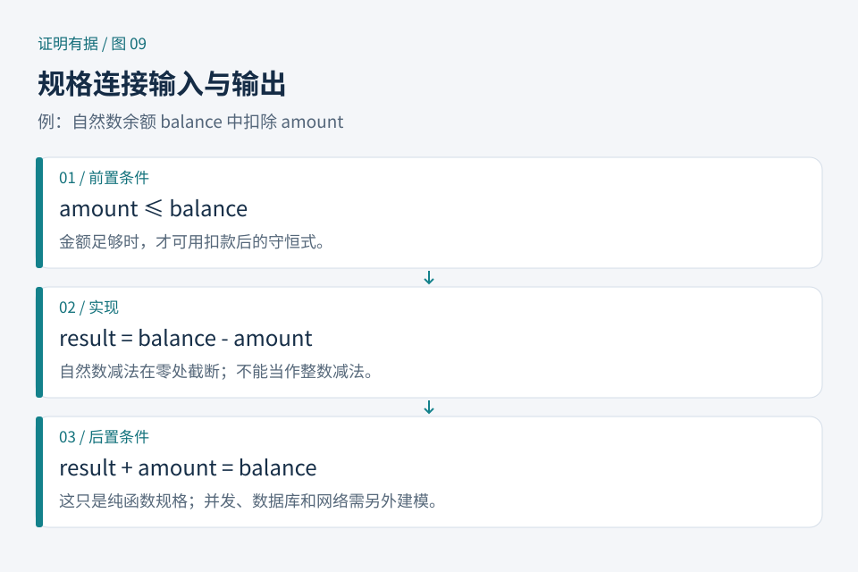

# 第09章　从函数到规格：究竟承诺什么

前几章已经证明过列表追加与长度的关系。现在把问题换成一段应用程序：读取一个余额，扣除一笔金额，返回新余额。写出一个能执行的函数很容易，困难在于先说明“正确”指什么。是否允许透支？金额是否可能为负？余额单位是元还是分？一旦这些问题没有说清，证明再严密，也可能认真证明了一份不合需求的承诺。

本章中的金额都用自然数表示，单位固定为分；只讨论单账户的纯计算，不涉及并发、持久化和外部支付。这个缩小后的模型足够展示规格如何指导设计，也让每一条保证都有明确对象。

*图 9：规格把输入条件与输出承诺连接起来。图中边界以外的网络、数据库和操作系统，不会因纯函数定理而自动获得保证。原创教学示意。*

## 9.1 前置条件与后置条件

若扣款函数是 `debit balance amount`，一种规格是：在 `amount ≤ balance` 时，返回值加上金额等于原余额。

这个条件包含两个部分。前置条件限定调用场景：余额足够。后置条件描述结果：金额守恒。它没有承诺记录日志，也没有说明失败时返回什么。

自然数减法还会带来一个容易忽视的细节：它通常在零处截断，因此 `2 - 5` 的结果不是负三。在这种模型中，等式 `(balance - amount) + amount = balance` 需要余额足够的假设。删掉假设，定理就会在余额二、扣款五时失败。

先手算这个反例，比盲目尝试策略更有用。证明失败可能来自表达不当、辅助引理缺失，也可能来自命题本身为假。证明助手不负责替作者判定哪一种情况正在发生。

这里的前后置思想也可写成 Hoare 三元组：`{P} command {Q}`。其中 `P` 描述执行前状态，`Q` 描述执行后状态；如果语言允许不终止，还必须区分“终止时结果正确”的部分正确性与“保证终止且结果正确”的完全正确性。初学时不要把两者合并成一句模糊的“验证通过”。[延伸：Software Foundations《Programming Language Foundations》，Hoare Logic](https://softwarefoundations.cis.upenn.edu/plf-current/Hoare.html)

## 9.2 用接口表达失败

另一种设计不要求调用者提前提供余额充足的证据，而是返回可失败的结果：余额充足时返回新余额，不足时返回空结果。Lean 可用 `Option Nat`，Rocq 可用 `option nat` 表达这样的输出。

两种接口解决的是不同的调用问题。

| 接口 | 谁承担余额检查 | 调用者能知道什么 |
|---|---|---|
| 输入带余额充足证据 | 调用者先提供证明 | 函数只接收合法扣款 |
| 返回可失败结果 | 函数执行判断 | 必须检查成功或失败 |

这里并不存在“带证明的一定更高级”的结论。外部输入往往需要运行时检查；库内部已知的不变量则适合用证据传递。实际系统可以先检查用户输入，再将检查结果转换为内部接口需要的证据。

一个良好的返回规格还要说明失败的意义。只证明“如果成功，金额守恒”会允许一个永远失败的函数满足该性质。若需求要求余额够时一定成功，就要再证明成功的充分条件；若需求要求不足时必须拒绝，就要证明拒绝条件。把这几项分别写出，才能发现规格是否漏掉了核心行为。

## 9.3 不变量怎样贯穿多步计算

考虑遍历一串收入，将它们累加到余额。若初始余额为 `b`，已处理的收入列表为 `done`，累计余额为 `acc`，可以选择不变量：

`acc = b + sum(done)`。

开始时 `done` 为空、和为零，不变量成立。每次取下一笔 `x`，余额增加 `x`，已处理列表的总和也增加 `x`，关系因而保持。全部处理完后，用 `done` 已覆盖整个输入得到最后的总额。

这就是循环不变量的三个检查点：初始化、保持、退出后的结论。对递归程序，类似信息经常成为归纳命题中的参数关系。它不是在代码旁写一句希望成立的话，而是一项必须随每步执行保持的数学关系。

如果将实现改成尾递归，就会出现额外累加器。只证明“从零开始返回总和”可能导致归纳假设太弱；把命题推广到任意初始累加器，才容易把一次递归调用接回结论。第七章中的“泛化”，在此获得了具体的程序意义。[延伸：Software Foundations，Hoare Logic 中循环规则](https://softwarefoundations.cis.upenn.edu/plf-current/Hoare.html)

## 9.4 程序提取与真实执行之间

Rocq 支持从定义或满足规格的构造中提取程序；提取过程可以消去主要用于证明的内容，并输出目标语言代码。提取设置还允许对部分常量指定目标语言实现，因此这些映射必须作为验证边界单独检查。[来源：Rocq 参考手册，Program extraction](https://docs.rocq-prover.org/master/refman/addendum/extraction.html)

Lean 也能编写和执行程序，但要分清“某个函数在逻辑模型中满足性质”与“具体生成的可执行文件在某台机器上按该模型运行”。后者还涉及编译器、运行时、外部调用和输入输出建模。不能看见证明与函数位于同一文件，就宣布整个应用已经被证明。

假设我们的余额纯函数已经验证。把它接入数据库后，两个请求可能同时读到旧余额，并各自通过检查。单次计算的定理没有描述这类交错执行。要证明并发正确性，必须引入事务或并发状态模型；要证明日志完整性，必须在规格中表达日志。模型每增加一类行为，就新增一组需要解释的假设。

## 9.5 从需求到可证明的任务

一个可操作的顺序是：先给出输入输出的例子；再指出非法输入和失败行为；随后选择数据模型；最后分别陈述安全性、功能性与终止性。在这个阶段，代码还可以很短，需求讨论却应当具体。

练习：某个排序函数只证明了“输出有序”，是否已经正确？

答案：还不够。一个总是返回空列表的函数也满足“输出有序”。通常还要证明输出是输入的排列，即元素及其重复次数得到保留。若需求还包括稳定性，就要说明相等键元素的相对顺序保持。这个练习说明：强大的证明工具不会自动补全弱规格。读者真正需要练习的能力，是把期望行为拆成互相补充、能够审阅的性质。
